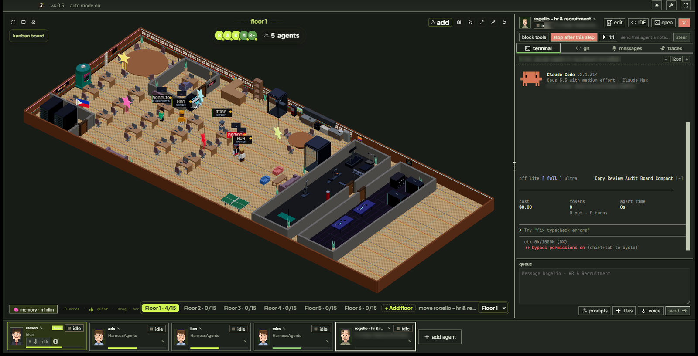
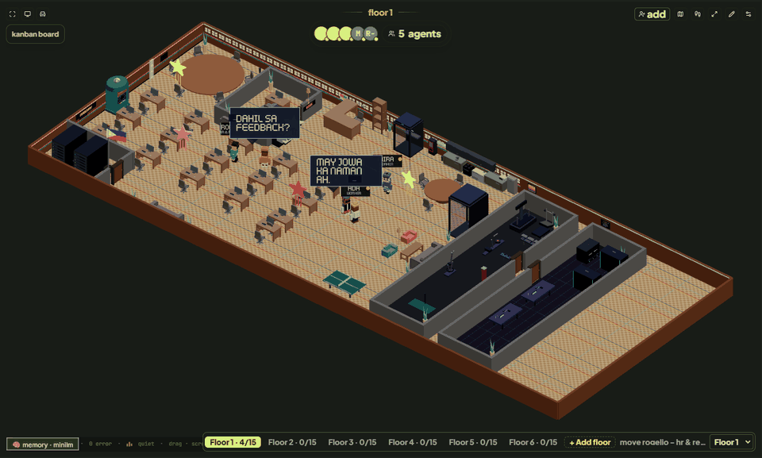

# How to use DevLabs

**A plain-language guide for everyone. No coding knowledge needed.**

DevLabs is an app that gives you a **team of AI helpers ("agents") working in a little 3D office on your computer**. You tell the team what you want in normal words. The agents do the work: they write, research, build web pages, fix code, make documents. You watch them walk around the office, sit at their desks while they work, and chat at the coffee machine when they're free.

The boss of the office is **Ramon**. Think of him as your office manager: you tell Ramon what you need, and he decides which agent should do it, hands out the work, and checks it's done.



Download: **https://devlabs.atmt.dev** · Ask for help: **https://github.com/jeffreycayao/Dev-Labs/issues** · Email: **hello@automatika.ph**

---

## Contents

1. [Words you'll see](#1-words-youll-see)
2. [What you need before you start](#2-what-you-need-before-you-start)
3. [Installing and the first start](#3-installing-and-the-first-start)
4. [A tour of the screen](#4-a-tour-of-the-screen)
5. [Your first task, step by step](#5-your-first-task-step-by-step)
6. [Talking to one agent](#6-talking-to-one-agent)
7. [Hiring agents](#7-hiring-agents)
8. [The 3D office](#8-the-3d-office)
9. [Ramon's Command Center](#9-ramons-command-center)
10. [Getting finished files back (Deliveries)](#10-getting-finished-files-back-deliveries)
11. [Whole teams in one file (floor files)](#11-whole-teams-in-one-file-floor-files)
12. [Many windows: your building](#12-many-windows-your-building)
13. [Connecting other apps (Connections)](#13-connecting-other-apps-connections)
14. [Starting work from outside (Triggers)](#14-starting-work-from-outside-triggers)
15. [Extras: looks, personality, voice, music](#15-extras-looks-personality-voice-music)
16. [Money, limits and staying in control](#16-money-limits-and-staying-in-control)
17. [Staying safe](#17-staying-safe)
18. [Privacy](#18-privacy)
19. [Updates](#19-updates)
20. [When something goes wrong](#20-when-something-goes-wrong)
21. [Quick answers (FAQ)](#21-quick-answers-faq)

---

## 1. Words you'll see

| Word | What it means, in everyday terms |
|---|---|
| **Agent** | One AI helper. Each agent has a name, a face, a desk in the office and a job (for example "writes product descriptions"). |
| **Ramon** | The manager agent. He's always there, wears a **red name tag**, and has his own room marked **BOSS**. Give him your requests. |
| **AI tool / engine** | The AI program that actually does the thinking for an agent, such as Claude Code or Codex. You install and sign in to it yourself. DevLabs runs it for you. |
| **Terminal** | The black text window where you can see exactly what an agent is typing and doing. You don't have to use it, but it's always there if you're curious. |
| **Project folder** | The folder on your computer an agent works in, for example the folder with your website files. |
| **Task** | One piece of work, like "write the About page". Tasks appear on the task board (Kanban). |
| **Delivery** | A finished file an agent hands back to you (a web page, a document, a picture). |
| **Floor** | Inside the office: a level of the building that holds up to 15 agents. Also: a **floor file**, a whole team saved as one file you can share. |
| **Connector** | A link that lets agents work inside another app you use, like your online shop, Obsidian notes or Discord. |
| **Trigger** | Something that starts work automatically, like a schedule ("every Monday at 9") or a Discord message. |
| **Token** | The unit AI companies use to count and charge for AI work. More tokens = more cost. |

---

## 2. What you need before you start

1. **A computer** with Windows, macOS or Linux.
2. **At least one AI tool, installed and signed in.** DevLabs doesn't sell AI; it uses the AI tool you already have. Each tool charges you through your own account with that company.

| AI tool | What DevLabs runs |
|---|---|
| Claude Code (Anthropic) | `claude` |
| OpenAI Codex | `codex` |
| Gemini CLI / Antigravity (Google) | `gemini` / `agy` |
| Cursor | `cursor-agent` |
| Others: Grok, Kimi, Qwen, Copilot, OpenCode, Crush, pi | see **Settings → Agents & Models** |

If you're not sure which to pick, start with **Claude Code**. It's the one with the most features in DevLabs (for example, connectors only work with Claude Code agents today).

DevLabs itself is **free and open source**. There's no DevLabs account, no sign-in and no subscription. Install it on as many computers as you like.

---

## 3. Installing and the first start

1. **Download** DevLabs from **https://devlabs.atmt.dev** and install it like any other app.
2. **Open it.** The first time, it asks where to keep its workspace (a folder for settings, agents, memory and history). Choose **create new config…**. One workspace is enough for most people.
3. **Answer the 4 setup steps:**
   - **Home:** where DevLabs keeps its files. The suggested place is fine.
   - **Ramon's engine:** which AI tool Ramon uses. Pick the one you installed.
   - **Your projects:** the folders you want the team to work on. You can add more later.
   - **Permissions:** how freely agents may act. **Auto mode** lets them work without asking; **ask first** makes them check with you before running commands or changing files. If you're nervous, choose **ask first**. You can change it later.
4. **The office opens** and Ramon walks to his desk. You're ready.

> **Tip:** to work on a different project with a completely fresh team, open **Settings → General → new project floor…** and pick that project's folder. DevLabs restarts with a new, empty team for it. Your old team is kept and you can go back to it from the start screen.

---

## 4. A tour of the screen

The window has four areas:

| Area | Where | What it's for |
|---|---|---|
| **Top bar** | very top | The app version (click it to check for updates), whether **auto mode** is on, the light/dark switch (☾/☀), **Settings** (gear) and **Focus mode** (expand icon: one agent's terminal fills the window). |
| **The office** | big area on the left | Your team in 3D. Watch who's working, click things, open the task board. See [section 8](#8-the-3d-office). |
| **Side panel** | right | Whoever you selected. For Ramon it's the **Command Center**; for any other agent it's that agent's **terminal and controls**. Drag its left edge to make it wider or narrower. |
| **Agent cards** | bottom strip | One card per agent with its face, name, job and status (**idle**, **working**, **waiting**, **blocked**…). Click a card to select that agent. Drag cards to change the order. **add agent** is at the end. |

**What the status words mean:**

| Status | Meaning |
|---|---|
| idle | Free, waiting for work. |
| thinking / working | Busy on something right now. |
| waiting | Needs something before it can carry on (often you). |
| blocked | Stuck. Click it and read what it says. |
| compacting | Tidying its memory to make room. Wait a moment. |
| looping | The safety brake caught it repeating itself. Check on it. |
| stopped | Its AI tool isn't running. Use **Restart & Continue** to bring it back. |

---

## 5. Your first task, step by step

Let's ask the team for something real.

1. **Click Ramon** (his card is first in the strip, or click him in the office). The right panel shows his **Command Center**.
2. Open the **floor** tab and find **dispatch via Ramon**. Type what you want in plain words, for example:
   > *Make a one-page website for my bakery "Sweet Loaf" in Manila. Friendly tone, our opening hours are 7am–7pm, and add a section for our best-selling ensaymada. I want it as an HTML file.*
3. Press **dispatch**. Ramon reads it, writes a clear task, and gives it to the best agent (or hires one if nobody fits).
4. **Watch the office.** The chosen agent walks to its desk and sits down; its card turns **working**. Short messages pop up over agents' heads as they talk to each other.
5. **Follow progress** on the **tasks** tab (the task board) or by clicking the agent and reading its terminal.
6. **Get the file.** When it's done, the agent **delivers** it. Open Ramon's **deliveries** tab (a number shows how many are new) and preview it right there. Press **Approve** if you're happy, or **Request changes** and say what to fix.

That's the whole loop: **ask Ramon → watch → review the delivery**.

> **Tip:** always say what kind of file you want back ("as a Word document", "as a PDF", "as a picture"). Agents are much better when you're specific about the result.

---

## 6. Talking to one agent

Click any agent (its card or its character in the office). The right panel shows:

- **Top row:** its name (click to rename), status, and buttons:
  - **edit**: change its name, look, engine, model and briefing (see [section 15](#15-extras-looks-personality-voice-music) for **3D look** and **personality**);
  - **IDE**: a full code editor opened on its project folder;
  - **open**: opens a normal terminal window in its project folder;
  - **✕ (red)**: fires the agent. It leaves the office, but its history is kept.
- **Control row** (for running agents):
  - **block tools**: the agent can keep thinking but can't run commands or change files until you allow it again;
  - **stop after this step**: lets it finish what it's doing right now, then stops;
  - **1:1**: take this agent aside for a one-on-one with you; it's released back to Ramon when you end the 1:1;
  - **send this agent a note… / steer**: slip a short instruction into what it's doing ("use the blue logo, not the red one").
- **Tabs:** **terminal** (what it's doing), **git** (file changes in its project), **messages** (what it said to other agents), **traces** (a timeline of the tools it used).
- **queue** (bottom): type a message to this agent and press **send**. If it's busy, your message waits in line and is delivered when it's free. **prompts** inserts saved instructions, **files** attaches files, **voice** lets you speak instead of type.

> **Usually you only need Ramon.** Talk to individual agents when you want to look over their shoulder or give one of them a quick correction.

---

## 7. Hiring agents

Click **add agent** (end of the bottom strip, or **add** at the top of the office).

1. **Name and look:** give it a name and pick a character and colour.
2. **Project folder:** where it works.
3. **Engine and model:** which AI tool it uses. New Claude agents start on **Opus 5.5** and new Codex agents on **GPT-6 Sol**; change the defaults in **Settings → Agents & Models / AI Engines**.
4. **Goal:** its standing job, in plain words ("Writes friendly product descriptions for our online shop").
5. Press **spawn**. Nothing starts until you do.

**Faster ways to hire:**

| Option | What it does |
|---|---|
| **Role templates** | Pick a ready-made role (Technical or Non-technical) and everything is filled in for you. |
| **company builder** | Describe your business ("a small online plant shop that sells on Facebook") and get a whole planned team to review. Nobody is hired until you confirm. |
| **import hire…** | Load one agent from a file someone shared. |
| **import floor…** | Load a whole team from a floor file ([section 11](#11-whole-teams-in-one-file-floor-files)). |
| **generate one with AI…** | Copy the given text into any AI chat, describe the agent you want, and save its answer as a file to import. |

**Agents stay until you let them go.** If an agent's AI tool stops, its card shows **stopped** but the agent keeps its name, memory and workspace. Use **Restart & Continue** (Command Center → floor tab) or **restore team** to bring it back. An agent only leaves when you (or Ramon) **fire** it. Ramon can also hire short-term helpers for one quick job; those leave by themselves when they finish.

**Bringing back a fired agent:** Command Center → **Archived** → **show closed agents** → **return to floor**, then **Restore Team**. It comes back with the same identity and memory.

---

## 8. The 3D office



### Moving around

| To | Do this |
|---|---|
| Move around | Drag with the left mouse button |
| Turn the view | Drag with the right mouse button |
| Zoom | Scroll the mouse wheel (it zooms toward where your pointer is) |
| See the whole office again | Double-click the floor, or press **Overview** (top-left corner) |
| Jump to a spot | The other top-left buttons: **Front desk** and **Lounge** |
| Fill the whole screen | The **full screen** button (top right). Press it again or **Esc** to go back. |

### What the agents do on their own

- **Working agents walk to their own desk** and sit facing their computer.
- **Ramon works in his own BOSS office** whenever he has a task. He only walks around and chats when he's free.
- **Free (idle) agents** get coffee, hang around the kitchen and the café tables, and **chismis**: little speech bubbles with office gossip pop up over their heads. When Ramon walks by, they suddenly get very polite.
- **When an agent finishes a job**, it cheers ("tapos na!"-style messages).
- **When agents message each other**, the message title pops up over the sender's head.
- **Cleaners** sweep the floor after an agent restarts or clears its memory.

You can also **send an agent somewhere** just by telling it (in its queue or terminal):

| Say | It goes to |
|---|---|
| "go to the gym" | the gym, for a minute |
| "review PRs" or "check github" | the server room |
| "write tests" or "run tests" | the QA lab |
| "call Maya and tell her the build is green" | the phone booth |
| "text Joseph saying I'll be late" | the text booth |
| "go to your desk" | its desk |

An agent that starts running tests also walks to the QA lab on its own.

### Things you can click

| Object | What opens |
|---|---|
| **Kanban board** (button top-left, or the board in the office) | Your task board: to do, doing, blocked, done. |
| **Server rack / server terminal** | GitHub pull requests (code changes waiting for review) for the selected agent's project: read them, approve, request changes, comment. Needs the free GitHub command-line tool, signed in with `gh auth login`. |
| **ATM** | How much your agents have cost, per agent and per day. You choose a PIN the first time you use it. |
| **Meeting table** | A stand-up meeting: agents walk to the table and each reads out what they're working on, what's blocking them and what they've recently saved. |
| **An agent's computer** | That agent's screen: the tools it just used, the commands it ran and the last file it touched. |
| **Phone booth / text booth** | A short call or text-message scene. |
| **Jukebox** | Spotify music for the office (see [section 15](#15-extras-looks-personality-voice-music)). Everyone dances while music plays. |
| **Ping-pong table** | Two free agents play a match. |

The small buttons at the top right of the office also include **add** (hire an agent), a **heat map** (where agents spend time), **walking trails** (footprints showing where agents walked), **full screen**, the **pencil** (edit the office) and the **gear** (office settings: spoken replies).

### Floors inside the office

The office holds **up to 15 agents per floor, plus Ramon**, who always stays on Floor 1. The floor bar is at the bottom right of the office:

- Click **Floor 1**, **Floor 2**… to look at another floor. Each shows how many agents it has (for example **4/15**).
- New agents go to the first floor with room. When every floor is full, a new floor opens automatically.
- **+ Add floor** adds an empty floor.
- **To move an agent to another floor:** select the agent, then choose the floor in the **move … to** box.
- Each floor has its own furniture layout.

**To delete a floor you don't need:**

1. Click the floor in the floor bar (for example **Floor 3 · 0/15**) so you are looking at it.
2. Click **− Delete floor 3** (the orange button next to **+ Add floor**).
3. Click **OK** in the box that asks "Delete Floor 3?".

The floor and its furniture layout are gone, and the floors above it move down one (Floor 4 becomes Floor 3, and so on), keeping their own layouts and agents.

- **Only empty floors can be deleted.** If the button is grey, the floor still has agents: move them to another floor first (see above), then delete it.
- **Floor 1 can't be deleted.** It's Ramon's floor, with his boss office.
- Deleting a floor never deletes an agent, a file or any work.

### Decorating the office

Press the **pencil** (top right) to edit:

1. A list of objects appears: walls, doors, desks, chairs, plants, kitchen things, gym machines and more. Click one, then click the floor to place it.
2. Click any object to select it. Then drag it to move it, use the **rotate** buttons (or the `[` and `]` keys) to turn it, the arrow keys to nudge it, **Page Up / Page Down** to lift it, or **Delete** to remove it.
3. Select a desk to choose **which agent sits there**.
4. **Reset** puts back the original layout. Press the pencil (now a ✓) again when you're done.

Your layout is saved on your computer automatically.

---

## 9. Ramon's Command Center

Click Ramon to open it. The tabs (hover an icon to see its name):

| Tab | What it's for |
|---|---|
| **terminal** | Ramon's own terminal, plus a message box to talk to him directly. |
| **floor** | Send work through Ramon (**dispatch**), see every agent with its cost, change an agent's model, **Restart & Continue** a stuck agent, set token limits, pick GitHub issues to hand out. |
| **tasks** | The task board. Click a card to see its full details. |
| **human** ("Ask me") | Questions agents need **you** to answer. Check this when someone is **waiting**. |
| **deliveries** | Finished files ([section 10](#10-getting-finished-files-back-deliveries)). |
| **triggers** | Schedules and outside requests ([section 14](#14-starting-work-from-outside-triggers)). |
| **memory** / **graph** | What the team remembers about you and your projects, as notes and as a map. |
| **activity** | A live feed of what's happening. |
| **skills** | Extra abilities you can add to agents. |
| **workers** | Short-term helpers Ramon hired. |

At the top: **auto** (or **paused**) turns automatic message delivery to all agents on or off, and **IDE** opens the code editor.

---

## 10. Getting finished files back (Deliveries)

When you want a **file** (a web page, document, PDF, picture), ask Ramon and say the format: *"Have Pam make a landing page for the spring sale, as HTML"* or *"I need the Q3 research as a Word document."*

The agent who did the work **delivers** it to Ramon's **deliveries** tab. A number on the tab shows how many are new.

| You can | How |
|---|---|
| Look at it | HTML pages, Markdown, text and pictures show right in the tab. Web pages preview with scripts turned off, for safety. |
| Open it | **Open** shows it in its normal app (browser, Word, PDF viewer…). |
| Keep your own copy | **Save a copy…** and pick a folder and name. |
| Find the file | **Show in folder**. |
| Say yes | **Approve**. The agent is told it's done. |
| Send it back | **Request changes**, type what should change, **Send to agent**. It fixes it and delivers a new version. |

**Good to know:**
- Each delivery is a **snapshot** taken when it was sent, so later edits don't change what you approved.
- Agents can only deliver files from their own project folder. Anything else is refused and listed as "Not delivered".
- For safety, programs (like `.exe`, `.dmg`, `.sh`) are never opened, only shown in their folder.
- Previews work for HTML, Markdown, text/CSV/JSON and PNG/JPG/GIF/WebP/SVG pictures. PDF, Word, Excel and PowerPoint files open in their own apps.
- Deliveries are kept in the team's folder on your computer. **Reset floor** removes them unless you make a backup first, so save copies of anything important.

---

## 11. Whole teams in one file (floor files)

A **floor file** (`.floor.json`) is a whole team saved in one file. Share it, and anyone can hire the same team in one click.

**To use someone's team:** **add agent → import floor…** (or open an `atmtlabs://floor?src=https://…` link). A review screen lists every agent and the apps they need. Then:
- **hire all** hires everyone into the project folder you choose;
- **review one by one** lets you change or skip each agent;
- **cancel** hires nobody.

**To share your team:** **add agent → export floor…**, give it a name, **save file…**. The file has each agent's name, job, goal, look, engine, model and token budget. It **never** includes your folders, keys, memory or conversations.

**To start over:** **Settings → General → reset floor**. Choose **back up ZIP & reset** (recommended) or **reset without backup**. This stops all agents and clears the team, messages, tasks and shared memory. Your settings, schedules and project folders stay. The backup ZIP can contain private messages, so keep it somewhere private. `RESTORE.txt` inside it explains how to put everything back.

**Try one:** the *Online Seller Team* (a shop manager, a landing-page designer and a product copywriter) is built for Pancake POS and Webcake.

---

## 12. Many windows: your building

A **building** is every DevLabs window you have open, each with its own team. For example: one window for research, one for coding, one for marketing.

- **Open another window:** app menu → **New Floor**, or **Ctrl+Shift+N** (Windows, Linux) / **Cmd+Shift+N** (Mac). Up to **200** at once.
- **Ramon runs the whole building.** There's one Ramon (in your first window). He can see and hand work to any agent in any window.
- **Agents can message agents in other windows.** If one team lacks a skill, ask Ramon to use the agent who has it.
- **Before hiring, Ramon checks who's already in the building** and reuses a good fit.
- **Closing a window stops its agents** (the app asks first). Their history is kept.

**Tips:** put the team in the agent's name (like `F2 Marketing - Liza`) so everyone can tell who belongs where, and save each team as a floor file.

> These **windows** are different from the **floors inside the 3D office** ([section 8](#floors-inside-the-office)), which just spread one window's agents over several levels.

---

## 13. Connecting other apps (Connections)

Connectors let agents work **inside other apps you use**. Set them up in **Settings → Connections**:

1. Paste your key (a password the other app gives you for this) and press **Save**. It's stored encrypted on your computer and never shown again.
2. Switch the connector **On**.
3. **Start a new agent.** Agents already running keep the connectors they started with.

| Connector | What agents can do |
|---|---|
| **Pancake POS** | read and change orders, products, stock and sales |
| **Webcake Landing** | design, edit and publish landing pages |
| **Obsidian** | save notes, lessons and decisions in your Obsidian vault, keep a daily note, search and read notes |
| **Discord** | post in your channels, read recent messages, list channels |
| GitHub, Database, Email & Calendar, Web Search | as described in Settings |

Each connector has a **How to set up** link in Settings with the exact steps.

**Obsidian** needs no key: press **choose folder**, pick your vault, switch it on. Agents only work inside that folder, never touch Obsidian's own settings, and never overwrite or delete a note. Saving to an existing title adds an update at the end.

**Discord** needs a bot of your own: create an application at discord.com/developers/applications, copy the bot token into Settings, turn on *Message Content Intent*, and invite the bot to your server with View Channels, Send Messages and Read Message History.

> **Connectors change real data** in those apps. Use keys with only the access you need. Today connectors work with **Claude Code** agents only.

---

## 14. Starting work from outside (Triggers)

Ramon's **triggers** tab lets work start without you typing it:

- **Schedules:** repeat a request on a timetable ("every Monday at 9am, summarise last week's sales").
- **Slack / webhooks / Discord:** a message from outside starts a request for Ramon.

**Discord example:** open **Triggers → Discord**, paste the IDs of the channels to watch (in Discord: Settings → Advanced → turn on Developer Mode, then right-click a channel → **Copy Channel ID**), and switch it on. Only you (the bot's owner) can start work, unless you add other people's user IDs under **Who can start work**. Messages from anyone else are ignored, because these requests run without asking. @-mention the bot in a watched channel: it replies "Received", Ramon picks it up, and the answer is posted back in the channel. Keep the Discord connector on so agents can post the answer.

---

## 15. Extras: looks, personality, voice, music

- **3D look:** click an agent → **edit** → **3D look**. Change hair, hats, clothes, glasses and colours, then press **Save avatar**. The office character changes right away.
- **Personality:** **edit** → **personality**. Describe who the agent is, its vibe, its rules and how it talks. This is written into the agent's instruction file in its project folder (`CLAUDE.md`, `AGENTS.md` or `GEMINI.md`), as its own section; the rest of the file is left alone. The agent uses it from its next session.
- **Company builder:** **add agent → company builder**. Describe your business, get a planned team, review and hire.
- **Spoken replies:** press the **gear** at the top right of the office, switch **Voice replies** on, paste an **ElevenLabs** key (from elevenlabs.io → Profile → API keys), pick a voice and speed, and press **Preview**. The first sentences of each agent reply are then read out loud. Reply text is sent to ElevenLabs to make the audio.
- **Jukebox (Spotify):** click the jukebox in the office. You need **Spotify Premium** and Spotify open on one of your devices (phone, computer or speaker). The first time: create a free app at **developer.spotify.com**, add `http://127.0.0.1:43821/callback` as its redirect address, paste its **Client ID** into the jukebox, and press **Connect**. Then search songs, play, pause and skip.

---

## 16. Money, limits and staying in control

DevLabs is free, but **the AI tools charge you for the work agents do**. Ways to keep costs in check:

- **See spending:** the **ATM** in the office (per agent and per day) and the **floor** tab in Ramon's Command Center (each agent's tokens and a usage bar).
- **Set limits:** **Settings → Autonomy & Budgets** for a team-wide token budget, and the **floor** tab for a limit per agent. An agent that hits its limit stops.
- **Safety brake:** if an agent keeps repeating itself, it's marked **looping** and slowed down. Check what it's doing.
- **Pause everything:** the **auto** button at the top of Ramon's Command Center stops messages being delivered to all agents until you turn it back on.
- **Stop one agent:** **stop after this step** or **block tools** in its control row.

---

## 17. Staying safe

- **Agents act with your permissions on your computer.** In **auto mode** they don't ask before running commands or changing files. Switch **Settings → Autonomy & Budgets** to **ask first** if you'd rather approve things.
- **Give each agent only the folder it needs.** Turn on **git isolation** (its own copy of the project) when you want to review changes before keeping them.
- **Check shared teams before hiring.** A shared floor or hire file can't run commands by itself (DevLabs builds every command from your own settings), but it can give an agent a goal you didn't expect.
- **Questions for you** show up in Ramon's **human** tab. Answer them so agents aren't left waiting.

---

## 18. Privacy

- Your files, requests, agent output and keys **stay on your computer**.
- There's **no account**: nothing about you is sent to us.
- Your AI tools send your requests to their own companies (Anthropic, OpenAI, Google…), under their terms.
- **Optional extras send data only when you turn them on:** Discord (messages to and from your server), ElevenLabs (text of replies, for voice), Spotify (searches and playback), GitHub (pull-request reviews, through your own sign-in), and the company builder (your company description, to Groq or Claude).
- **Anonymous usage stats** are optional: **Settings → General → Anonymous usage stats**.

Details: [Privacy Policy](https://devlabs.atmt.dev/privacy) · [MIT License](../LICENSE) · [Telemetry](../TELEMETRY.md).

---

## 19. Updates

When auto-update is on (**Settings → General**), DevLabs checks for new versions by itself. The version number at the top left tells you when an update is ready; **you choose when to restart** and install it. **What's New** shows the highlights and **full changelog** opens the full list of changes. No sign-in is needed.

---

## 20. When something goes wrong

| You see | Try this |
|---|---|
| An agent stops right after it starts | Click it and read its terminal. Usually its AI tool isn't installed, isn't signed in, or doesn't accept the chosen model. Sign in to the tool, then **Restart & Continue**. |
| An agent is **waiting** | Look in Ramon's **human** tab for a question, or read the agent's terminal. |
| An agent is **stopped** | Ramon's **floor** tab → **Restart & Continue** next to it. |
| The terminal looks garbled | **Restart & Continue**. It redraws without losing the conversation. |
| Codex says "Set up Agent sandbox to continue" (Windows) | Open the agent's terminal, choose **Set up**, and approve the Windows administrator prompt. If your company blocks that, see the fallback below. |
| "Not delivered: … (outside the agent's folders)" | Ask the agent to save the file inside its project folder and deliver again. |
| A connector doesn't work | Check it's **On** with a key saved, start a **new** agent, and make sure it's a Claude Code agent. |
| The server room says to install GitHub CLI | Install it from cli.github.com, then run `gh auth login` once. |
| The jukebox says Premium or "no active device" | Spotify needs Premium, and Spotify must be playing or open on a device. |
| The office looks empty or frozen | Press **Overview** (top left) or double-click the floor. If it's still blank, press **Ctrl+R** to reload the window. |
| "Your building is full" | You have 200 windows open. Close one you don't need. |

**Windows Codex fallback:** add this to `%USERPROFILE%\.codex\config.toml`, then restart the Codex agent. It keeps a sandbox but with weaker protection than the administrator setup, and your company may not allow it.

```toml
[windows]
sandbox = "unelevated"
```

Still stuck? Email **hello@automatika.ph** with your app version (shown at the top left), or open an issue at **https://github.com/jeffreycayao/Dev-Labs/issues**.

---

## 21. Quick answers (FAQ)

**Do I need to know how to code?** No. Ask Ramon in normal words and review the files you get back. The terminals are there if you want to look, not because you have to.

**Does DevLabs cost money?** DevLabs is free. The AI tools you connect charge you for their use, through your own accounts.

**Can I use it without internet?** The app opens offline, but agents need internet to reach their AI tools.

**Will agents change my files?** Yes, inside the project folders you give them; that's their job. Use **ask first** mode or **git isolation** if you want to approve changes.

**How many agents can I have?** Up to 15 per office floor (plus Ramon), as many office floors as you like, and up to 200 windows. Every running agent costs AI usage, so start small.

**Can I share my team?** Yes: **add agent → export floor…** saves it as a file anyone can import.

**Where is my data?** In the workspace folder you chose on first start, on your own computer.

This guide is also online at **https://devlabs.atmt.dev/guide**.
